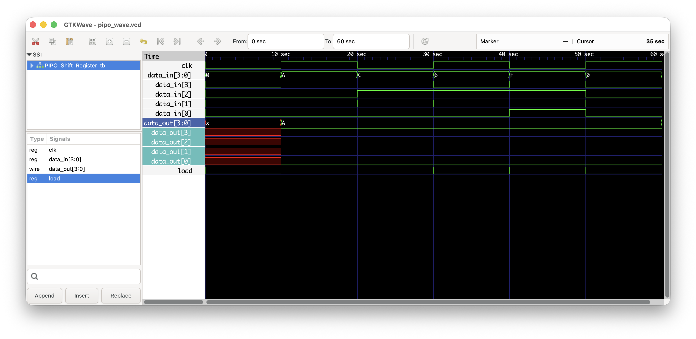
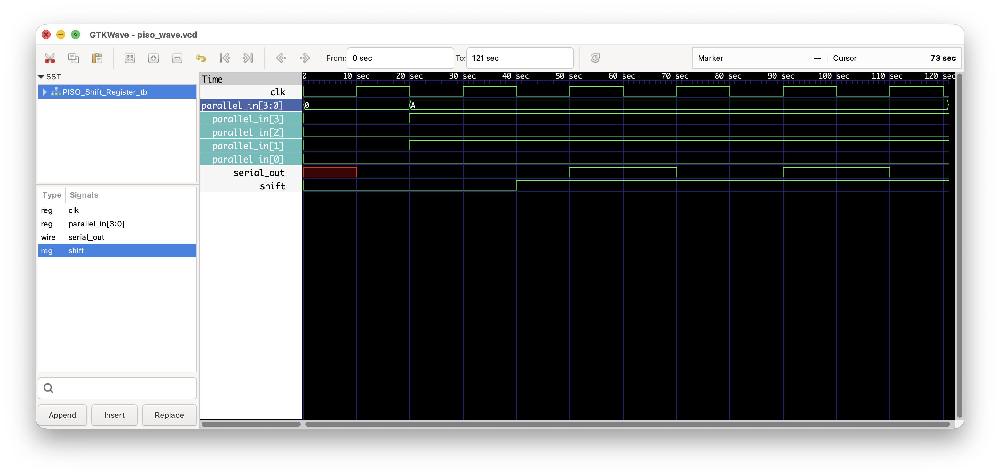

# 4-bit Shift Register (PIPO & PISO) in Verilog

**Course:** Digital Logic Circuit Design (DLCD) Lab Project
**Problem 4:** Design & implement a 4-bit Shift Register (parallel-in parallel-out & parallel-in serial-out)

## Team

| Name | USN |
|------|-----|
| Rahul P | PES1UG25AM510 |
| Rohith M | PES1UG25AM512 |
| S Banuteja Reddy | PES1UG25AM513 |
| Sambhram Laxman Sattigeri | PES1UG25AM516 |

## Problem Statement

Design and implement a 4-bit shift register in two configurations, PIPO and PISO, using Verilog HDL, and verify both with test benches.

## Description

### PIPO (Parallel-In Parallel-Out)
On a clock edge with `load = 1`, the 4-bit `data_in` is loaded into the register and appears on `data_out`. With `load = 0`, the output holds its value.

### PISO (Parallel-In Serial-Out)
With `shift = 0`, `parallel_in` is loaded into an internal 4-bit register. With `shift = 1`, the register shifts on every clock edge and one bit is presented on `serial_out`.

## Function Tables

**PIPO**

| clk | load | data_out[3:0] |
|-----|------|---------------|
| ↑ | 1 | data_in[3:0] |
| ↑ | 0 | No change |

**PISO**

| clk | shift | Operation |
|-----|-------|-----------|
| ↑ | 0 | Parallel load `parallel_in` |
| ↑ | 1 | Shift, bit appears on `serial_out` |

## Repository Structure

```
├── src/    # Verilog design files (PIPO, PISO)
├── tb/     # Test benches
├── output/ # Waveforms and simulation log
├── docs/   # Circuit diagrams and project report
└── README.md
```

## Interfaces

| Module | Inputs | Outputs |
|--------|--------|---------|
| `PIPO_Shift_Register` | `clk`, `load`, `data_in[3:0]` | `data_out[3:0]` |
| `PISO_Shift_Register` | `clk`, `shift`, `parallel_in[3:0]` | `serial_out` |

## How to Run

Tool: Icarus Verilog + GTKWave.

```bash
# PIPO
iverilog -o sim_pipo src/PIPO_Shift_Register.v tb/PIPO_Shift_Register_tb.v
vvp sim_pipo
gtkwave pipo_wave.vcd

# PISO
iverilog -o sim_piso src/PISO_Shift_Register.v tb/PISO_Shift_Register_tb.v
vvp sim_piso
gtkwave piso_wave.vcd
```

## Results

| PIPO | PISO |
|------|------|
|  |  |

Console output: [`output/simulation_log.txt`](output/simulation_log.txt)

## Circuit Diagrams


## Report

Full project report: [`docs/Project_Report.pdf`](docs/Project_Report.pdf)

## References

1. D. M. Harris and S. L. Harris, *Digital Design and Computer Architecture*, Morgan Kaufmann.
2. GeeksforGeeks, "Shift Registers in Digital Electronics." https://www.geeksforgeeks.org/digital-logic/shift-registers-in-digital-electronics/